# Adaptive Market Maker — research report: `synthetic_informed_baseline`

> **SYNTHETIC DATA (Mode 2).** These results come from the project's simulated order-level market, not from historical market data. They test whether the research machinery behaves correctly on a market with known properties; they are **not evidence that any strategy is profitable in a real market**.

_A (fixed spread) vs B (inventory-aware) vs C (alpha-aware) vs D (regime rules) on 4 held-out synthetic sessions with informed flow; parameters chosen on 2 validation sessions._

## 1. Executive summary

| strategy | net P&L (primary) | 95% CI | gross P&L | fees net of rebates | fills | mean abs inventory (sh) | worst max drawdown |
|---|---|---|---|---|---|---|---|
| A fixed spread | $1,883.20 | [$1,684.60, $2,067.22] | $854.00 | -$1,029.20 | 5,162 | 248 | $23.30 |
| B inventory-aware | $1,970.30 | [$1,843.69, $2,099.63] | $634.00 | -$1,336.30 | 6,692 | 99 | $15.10 |
| C alpha-aware | $2,281.10 | [$2,162.58, $2,388.41] | $881.00 | -$1,400.10 | 7,008 | 95 | $8.70 |
| D regime rules | $1,901.80 | [$1,771.43, $2,018.00] | $992.00 | -$909.80 | 4,562 | 121 | $9.30 |

Net P&L is after modelled fees and rebates with any residual inventory liquidated at the far touch (walking visible depth, taker fee). Fees below zero are net rebates. Confidence intervals come from a circular block bootstrap of 60-second P&L intervals.

**Hypothesis verdicts (mechanical, 95% intervals):**

- **H1** (C beats A on risk-adjusted net P&L): supported; mean/std of interval P&L 3.626 vs 1.769, difference 1.857 [1.195, 3.013]. Raw net P&L difference per interval $3.553 [$2.019, $5.018] (supported).
- **H2** (features predict out of sample): supported; test log-loss gain of `hgb` vs prior 0.2394 nats [0.2253, 0.2535].
- **H3** (alpha survives costs: C beats B): supported; $2.775 per interval [$1.944, $3.595].
- **H4** (inventory control improves risk-adjusted P&L: B vs A): supported; risk-adjusted difference 1.158 [0.744, 1.754]; raw net P&L not established (95% CI includes 0); mean abs inventory 248 → 99 shares.
- **H5** (fill-aware quoting): GLFT quotes with the estimated fill intensity earned $1,920.40 vs $1,970.30 for B (5,261 vs 6,692 fills); point estimate only.
- **H6** (regime dependence), C − B mark-to-mid P&L by regime: volatility=high: $128; volatility=low: $95; volatility=mid: $88; spread=1 tick: $248; spread=>1 tick: $62; flow=balanced: $71; flow=directional: $240 (descriptive).
- **H7** (robustness): see section 13 for every sensitivity grid and where results change sign.

## 2. Research question and hypotheses

Does a market maker that adapts its quotes to short-horizon price forecasts, execution conditions and inventory risk outperform simpler market makers under realistic replay assumptions?

| hypothesis | experiment | metric | baseline | verdict |
|---|---|---|---|---|
| H1 adaptive > fixed, risk-adjusted | test backtests | paired mean/std of interval net P&L | A fixed spread | supported |
| H2 incremental short-horizon information | direction models + feature ablations | test log loss vs prior; Δ when dropping flow groups | constant-probability prior | supported |
| H3 signal survives costs | C vs B (identical except alpha) | paired interval net P&L | B inventory-aware | supported |
| H4 inventory control improves risk-adjusted P&L | B vs A | paired mean/std of interval net P&L; inventory | A fixed spread | supported |
| H5 fill-aware quoting | GLFT with estimated fill intensity vs B | net P&L (point estimate) | B | point estimate only |
| H6 regime dependence | P&L by causal regime | P&L per regime | C vs B by regime | descriptive |
| H7 robustness | sensitivity grids | sign changes of net P&L | selected configuration | descriptive |

## 3. Dataset and quality assessment

Dataset `synthetic_informed` (source: **synthetic**).

| session | messages | observable states | mid drift (ticks) | validation | flagged checks |
|---|---|---|---|---|---|
| SYNTH_2099-01-05 | 77,620 | 75,949 | -15.5 | PASSED | none |
| SYNTH_2099-01-06 | 77,399 | 75,732 | -30.5 | PASSED | none |
| SYNTH_2099-01-07 | 77,562 | 75,909 | 17.5 | PASSED | none |
| SYNTH_2099-01-08 | 77,971 | 76,237 | -15.5 | PASSED | none |
| SYNTH_2099-01-09 | 78,495 | 76,831 | -13.5 | PASSED | none |
| SYNTH_2099-01-12 | 77,637 | 75,920 | 6.0 | PASSED | none |
| SYNTH_2099-01-13 | 78,172 | 76,490 | 1.5 | PASSED | none |
| SYNTH_2099-01-14 | 77,554 | 75,803 | -8.0 | PASSED | none |
| SYNTH_2099-01-15 | 77,369 | 75,653 | -28.5 | PASSED | none |
| SYNTH_2099-01-16 | 77,905 | 76,173 | 12.5 | PASSED | none |

Mid drift (last − first mid) matters for reading side-specific markouts: in a session that drifts down, buy fills look adversely selected and sell fills look favourable, independent of the strategy.


Every book-changing message was reconciled against the source book snapshot (check `book_transitions_consistent`); critical failures stop the pipeline. Messages sharing one timestamp are treated as one observable state (only the last book in a burst could be observed).

| role | session | start (s after midnight) | end | duration (s) |
|---|---|---|---|---|
| train | SYNTH_2099-01-05 | 34,320.0 | 35,970.0 | 1,650 |
| train | SYNTH_2099-01-06 | 34,320.0 | 35,970.0 | 1,650 |
| train | SYNTH_2099-01-07 | 34,320.0 | 35,970.0 | 1,650 |
| train | SYNTH_2099-01-08 | 34,320.1 | 35,969.9 | 1,650 |
| val | SYNTH_2099-01-09 | 34,320.0 | 35,970.0 | 1,650 |
| val | SYNTH_2099-01-12 | 34,320.0 | 35,970.0 | 1,650 |
| test | SYNTH_2099-01-13 | 34,320.1 | 35,969.9 | 1,650 |
| test | SYNTH_2099-01-14 | 34,320.1 | 35,969.9 | 1,650 |
| test | SYNTH_2099-01-15 | 34,320.0 | 35,970.0 | 1,650 |
| test | SYNTH_2099-01-16 | 34,320.0 | 35,970.0 | 1,650 |

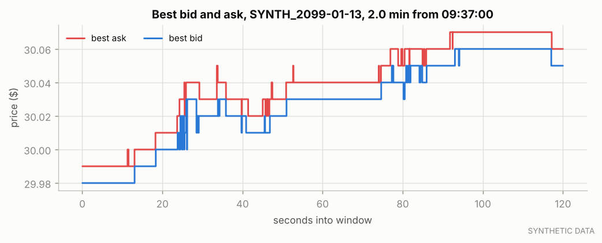

*Best bid and ask over a representative interval of the first test session.*

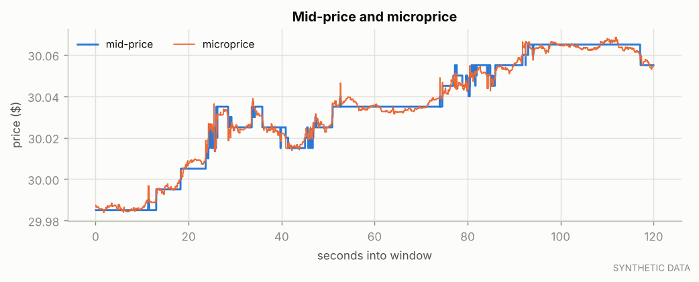

*Mid-price and microprice.*

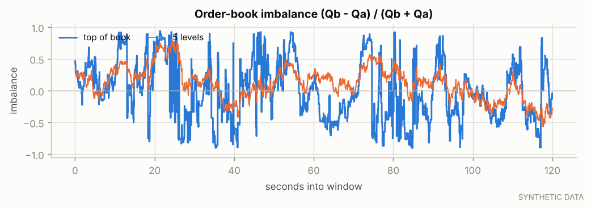

*Top-of-book and 5-level imbalance.*

## 4. Methodology

1. Validate data; build causal features on observable states; labels = as-of mid change over the horizon.
2. Chronological train / validation / test segments; labels purged at segment ends.
3. Direction models fit on train, temperature-calibrated on the first half of validation, selected by log loss on the second half (non-overlapping labels).
4. Strategy parameters chosen on validation only from small pre-declared grids; C inherits B's choice so C − B isolates the alpha component.
5. Every strategy is run once on identical test segments; robustness grids and ablations are reported on test but never used to re-select anything.

## 5. Feature definitions

See `docs/mathematical_model.md` for formulas. Feature groups used by the models:

42 features: `spread_ticks`, `imb_l1`, `log_bid_sz1`, `log_ask_sz1`, `micro_minus_mid`, `imb_l3`, `log_depth_ratio_l3`, `imb_l5`, `log_depth_ratio_l5`, `imb_l10`, `log_depth_ratio_l10`, `d_best_bid_e1`, `d_best_ask_e1`, `ret_e10`, `ret_e50`, `ret_e200`, `ret_t1`, `ret_t5`, `ret_t30`, `rv_t30`, `ofi_e10`, `ofi_e50`, `ofi_e200`, `ofi_t1`, `ofi_t5`, `ofi_t30`, `signed_vol_t1`, `trade_imb_t1`, `mo_rate_t1`, `signed_vol_t5`, `trade_imb_t5`, `mo_rate_t5`, `signed_vol_t30`, `trade_imb_t30`, `mo_rate_t30`, `cancel_rate_t5`, `submit_rate_t5`, `update_rate_t5`, `touch_replenish_t5`, `secs_since_mid_change`, `secs_since_trade`, `session_frac`

## 6. Predictive-model evaluation

Target: ternary sign of the as-of mid change over **1000ms**. Train/val-cal/val-select/test samples: 278,522 / 70,283 / 1,611 / 6,445 (validation-select and test use non-overlapping labels).

| model | T | val log loss | test log loss | test gain vs prior (95% CI) | accuracy | balanced acc. | Brier | AUC up | AUC dir. given move | IC (Spearman) |
|---|---|---|---|---|---|---|---|---|---|---|
| prior | 1.00 | 0.7269 | 0.7480 | — | 0.743 | 0.333 | 0.4149 | 0.500 | 0.500 | n/a |
| logistic | 1.02 | 0.4799 | 0.5120 | 0.2360 [0.2208, 0.2513] | 0.783 | 0.527 | 0.3049 | 0.878 | 0.872 | 0.458 |
| **hgb** | 1.03 | 0.4750 | 0.5086 | 0.2394 [0.2253, 0.2535] | 0.774 | 0.510 | 0.3087 | 0.875 | 0.888 | 0.448 |

Selected (bold): `hgb`. Test class balance (down/flat/up): -1: 13.0%, 0: 74.3%, 1: 12.7%. Accuracy alone is misleading when the flat class dominates; log loss and the directional AUC are the informative measures.

| regime dimension | regime | n | log loss | accuracy | AUC up |
|---|---|---|---|---|---|
| volatility | high | 2,780 | 0.5259 | 0.763 | 0.869 |
| volatility | low | 1,931 | 0.4826 | 0.784 | 0.875 |
| volatility | mid | 1,734 | 0.5097 | 0.782 | 0.881 |
| spread | 1 tick | 5,911 | 0.4653 | 0.798 | 0.875 |
| spread | >1 tick | 534 | 0.9871 | 0.515 | 0.612 |

Selected model by test session:

| session | n | log loss | accuracy | AUC up |
|---|---|---|---|---|
| SYNTH_2099-01-13 | 1,611 | 0.5223 | 0.764 | 0.869 |
| SYNTH_2099-01-14 | 1,612 | 0.5143 | 0.775 | 0.879 |
| SYNTH_2099-01-15 | 1,611 | 0.5007 | 0.777 | 0.875 |
| SYNTH_2099-01-16 | 1,611 | 0.4970 | 0.782 | 0.876 |

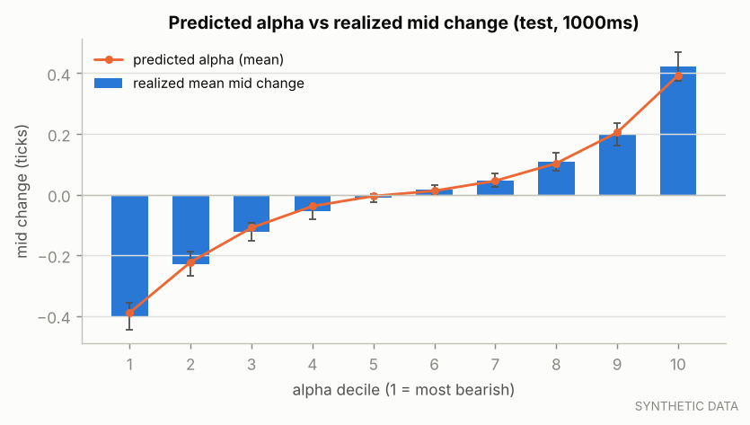

*Realized mid change by decile of the model's alpha (test); bars show ±1.96 SE.*

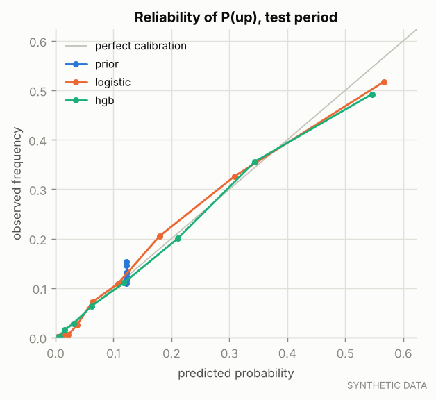

*Reliability diagram for P(up) on the test period.*

## 7. Execution simulator and assumptions

| assumption | value |
|---|---|
| execution mode | synthetic_market_replay |
| fill preset | central |
| latency (µs, per hop) | {"market_data_us": 250.0, "decision_us": 20.0, "order_entry_us": 250.0, "report_us": 250.0} |
| fees ($/share) | {"maker_per_share": -0.002, "taker_per_share": 0.003} |
| post-only quotes | True |
| flatten before end (s) | 30.0 |
| risk limits | {"max_inventory": 500, "max_order_size": 300, "max_outstanding_per_side": 300, "max_notional": 250000.0, "max_actions_per_second": 20.0, "max_market_spread_ticks": 10, "max_price_deviation_ticks": 10, "max_session_loss": 2000.0, "stale_data_s": 5.0} |

The central preset tracks the visible queue ahead of each simulated order exactly using order ids (orders whose submission was never seen rested earlier and are ahead; later orders are behind). Simulated orders do not change other participants' behaviour and do not remove liquidity from the historical record. See `docs/execution_assumptions.md`.

**Fill-probability model** (shadow 1-lot orders, 10.0 s horizon, preset `central`): test n = 4,000, observed fill rate 61.2% (by ticks behind best: 0: 84.6%, 1: 37.8%); Brier 0.1545 vs base-rate 0.2375; AUC 0.848.
 Estimated fill intensity λ(δ) = A·exp(−kδ): A = 0.419 /s, k = 1.406 /tick (training shadow orders).

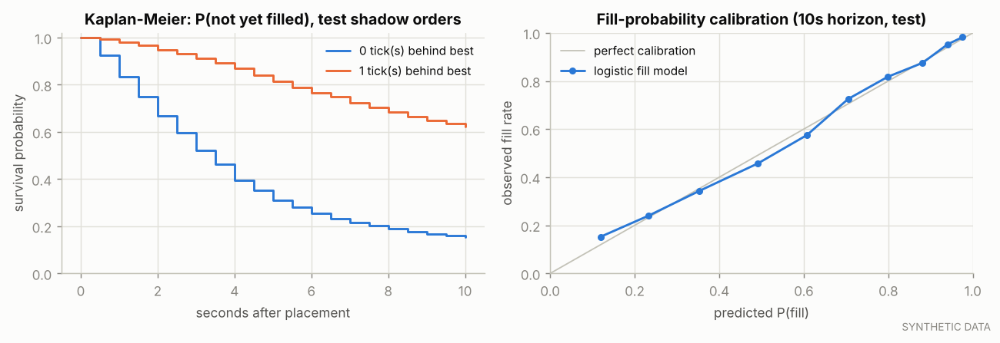

*Time-to-fill survival curves and fill-probability calibration (test shadow orders).*

## 8. Strategy definitions and selected parameters

A: fixed half-spread around the mid. B: Avellaneda–Stoikov-style reservation price r = S − q·γ·σ²·τ (q in lots, σ in ticks/√s, rolling τ) with the same half-spread as A. C: B plus r += clip(α) and an adverse-selection guard that withdraws the side α says will be picked off. D: C plus causal regime rules (stop quoting in high realized volatility, widen when the market spread is wide).

| strategy | selected on validation | candidates | validation net P&L by candidate |
|---|---|---|---|
| A fixed spread | {"half_spread_ticks": 0.5} | 2 | {"half_spread_ticks": 0.5} → $892.30; {"half_spread_ticks": 1.5} → $213.90 |
| B inventory-aware | {"gamma": 0.02} | 3 | {"gamma": 0.02} → $900.20; {"gamma": 0.1} → $706.60; {"gamma": 0.3} → $687.60 |
| C alpha-aware | {"alpha_guard_ticks": null} | 3 | {"alpha_guard_ticks": 0.15} → $743.10; {"alpha_guard_ticks": 0.3} → $962.90; {"alpha_guard_ticks": null} → $1,030.40 |
| D regime rules | defaults | 1 | {} → $867.70 |

## 9. Backtesting methodology

Event-driven replay with explicit latency; historical messages win timestamp ties. Each strategy ran on the same 4 test segment(s) with identical data, fees, latency, limits and simulator. 498 backtests were run in total (all logged in `trials.csv`).

## 10. Benchmark results

| strategy | net P&L | net P&L (mid-marked) | orders | fills | fill rate | shares traded | max abs inventory | net P&L / share | mean/std of 60s P&L |
|---|---|---|---|---|---|---|---|---|---|
| A fixed spread | $1,883.20 | $1,883.20 | 10,070 | 5,162 | 51.3% | 516,600 | 500 | $0.0036 | 1.865 |
| B inventory-aware | $1,970.30 | $1,970.30 | 12,747 | 6,692 | 52.5% | 669,400 | 500 | $0.0029 | 2.945 |
| C alpha-aware | $2,281.10 | $2,281.10 | 15,439 | 7,008 | 45.4% | 700,800 | 500 | $0.0033 | 3.638 |
| D regime rules | $1,901.80 | $1,901.80 | 14,782 | 4,562 | 30.9% | 456,400 | 500 | $0.0042 | 3.007 |

Per-segment results:

| strategy | segment | net P&L | fills | mean abs inv. | max drawdown | kill switch |
|---|---|---|---|---|---|---|
| A fixed spread | SYNTH_2099-01-13 | $467.40 | 1,299 | 239 | $17.30 |  |
| A fixed spread | SYNTH_2099-01-14 | $532.10 | 1,328 | 221 | $18.90 |  |
| A fixed spread | SYNTH_2099-01-15 | $440.80 | 1,273 | 280 | $23.30 |  |
| A fixed spread | SYNTH_2099-01-16 | $442.90 | 1,262 | 252 | $21.20 |  |
| B inventory-aware | SYNTH_2099-01-13 | $498.60 | 1,698 | 97 | $9.80 |  |
| B inventory-aware | SYNTH_2099-01-14 | $505.70 | 1,676 | 97 | $11.20 |  |
| B inventory-aware | SYNTH_2099-01-15 | $471.60 | 1,697 | 105 | $15.10 |  |
| B inventory-aware | SYNTH_2099-01-16 | $494.40 | 1,621 | 96 | $13.50 |  |
| C alpha-aware | SYNTH_2099-01-13 | $599.20 | 1,816 | 94 | $3.60 |  |
| C alpha-aware | SYNTH_2099-01-14 | $562.50 | 1,770 | 89 | $5.60 |  |
| C alpha-aware | SYNTH_2099-01-15 | $568.30 | 1,744 | 90 | $4.70 |  |
| C alpha-aware | SYNTH_2099-01-16 | $551.10 | 1,678 | 106 | $8.70 |  |
| D regime rules | SYNTH_2099-01-13 | $494.10 | 1,188 | 121 | $4.60 |  |
| D regime rules | SYNTH_2099-01-14 | $454.10 | 1,108 | 115 | $9.30 |  |
| D regime rules | SYNTH_2099-01-15 | $506.10 | 1,148 | 117 | $6.60 |  |
| D regime rules | SYNTH_2099-01-16 | $447.50 | 1,118 | 130 | $8.50 |  |

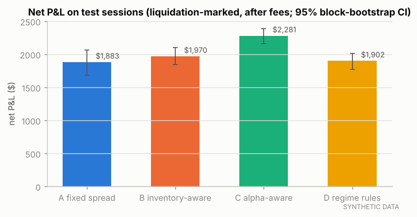

*Net P&L by strategy on the test segments.*

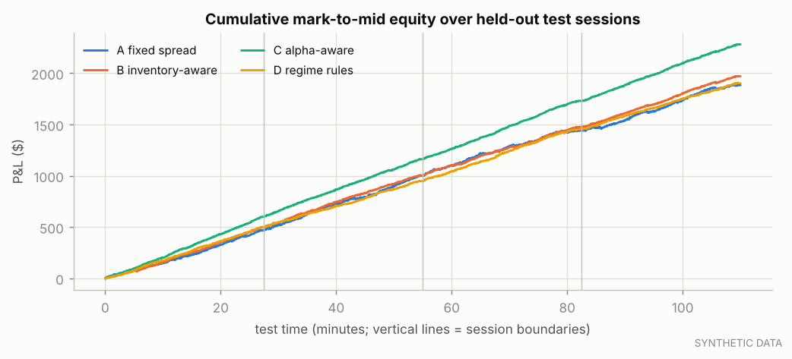

*Cumulative equity across test segments.*

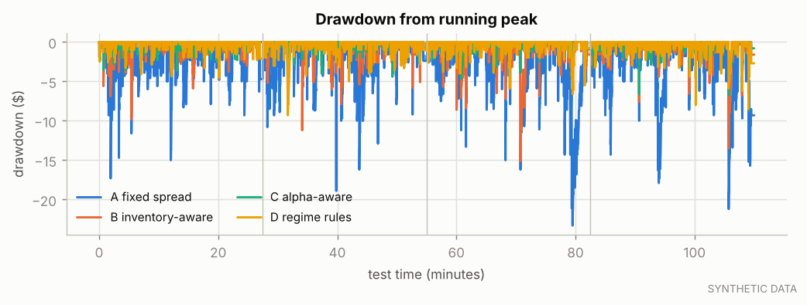

*Drawdown from the running peak.*

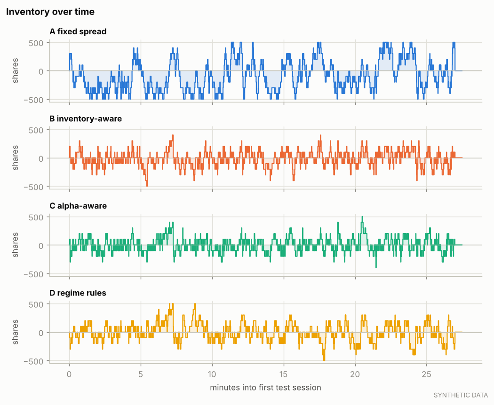

*Inventory paths in the first test session.*

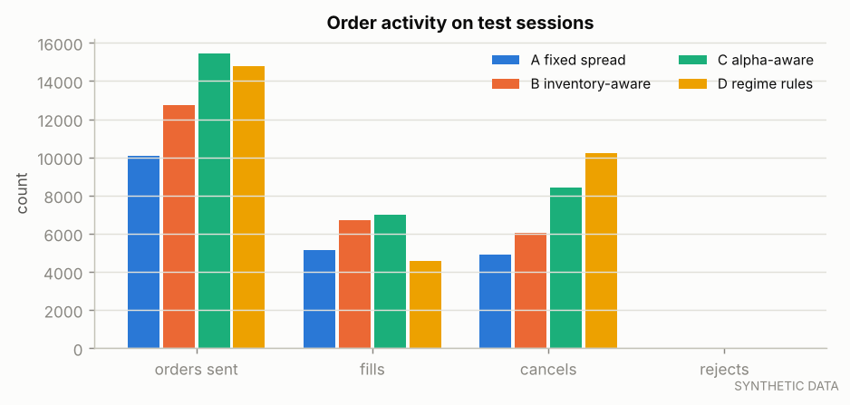

*Order, fill, cancel and reject counts.*

## 11. Transaction costs and adverse selection

Per maker fill (ticks per share, side-signed so positive = good for us): effective half-spread e = s(M₀ − P); adverse selection AS_h = −s(M_h − M₀); realized spread RS_h = e − AS_h = s(M_h − P). Fees are excluded here and added once in the last column.

| strategy | maker fills | e | RS 100ms | RS 1000ms | RS 5000ms | RS 30000ms | AS 30000ms | net $/share (longest h, incl. fees) |
|---|---|---|---|---|---|---|---|---|
| A fixed spread | 5,158 | 0.448 | 0.297 | 0.250 | 0.191 | 0.167 | 0.281 | $0.00363 |
| B inventory-aware | 6,689 | 0.353 | 0.165 | 0.149 | 0.105 | 0.100 | 0.253 | $0.00300 |
| C alpha-aware | 7,005 | 0.334 | 0.138 | 0.149 | 0.125 | 0.132 | 0.202 | $0.00331 |
| D regime rules | 4,558 | 0.318 | 0.155 | 0.213 | 0.208 | 0.223 | 0.095 | $0.00422 |

| strategy | side | fills | e (ticks) | RS longest h (ticks) |
|---|---|---|---|---|
| A fixed spread | sell | 2,579 | 0.448 | 0.313 |
| A fixed spread | buy | 2,583 | 0.447 | 0.018 |
| B inventory-aware | sell | 3,347 | 0.353 | 0.268 |
| B inventory-aware | buy | 3,345 | 0.353 | -0.068 |
| C alpha-aware | sell | 3,504 | 0.333 | 0.301 |
| C alpha-aware | buy | 3,504 | 0.335 | -0.038 |
| D regime rules | sell | 2,280 | 0.322 | 0.388 |
| D regime rules | buy | 2,282 | 0.312 | 0.057 |


Maker realized spread at the longest horizon by causal regime at the time of the fill (ticks):

| dimension | regime | A fixed spread | B inventory-aware | C alpha-aware | D regime rules |
|---|---|---|---|---|---|
| volatility | low | 0.201 (n=1,403) | 0.140 (n=1,880) | 0.178 (n=1,911) | 0.245 (n=1,396) |
| volatility | mid | 0.141 (n=1,371) | 0.112 (n=1,868) | 0.141 (n=1,899) | 0.226 (n=1,285) |
| volatility | high | 0.162 (n=2,384) | 0.067 (n=2,941) | 0.099 (n=3,195) | 0.203 (n=1,877) |
| spread | 1 tick | 0.240 (n=3,470) | 0.181 (n=4,491) | 0.201 (n=4,814) | 0.250 (n=3,520) |
| spread | >1 tick | 0.016 (n=1,688) | -0.066 (n=2,198) | -0.020 (n=2,191) | 0.129 (n=1,038) |
| flow | balanced | 0.232 (n=2,198) | 0.187 (n=2,784) | 0.184 (n=3,077) | 0.291 (n=1,972) |
| flow | directional | 0.119 (n=2,960) | 0.038 (n=3,905) | 0.092 (n=3,928) | 0.170 (n=2,586) |
| depth | thin | 0.208 (n=2,907) | 0.115 (n=3,921) | 0.139 (n=4,295) | 0.212 (n=2,925) |
| depth | deep | 0.114 (n=2,251) | 0.079 (n=2,768) | 0.121 (n=2,710) | 0.241 (n=1,633) |

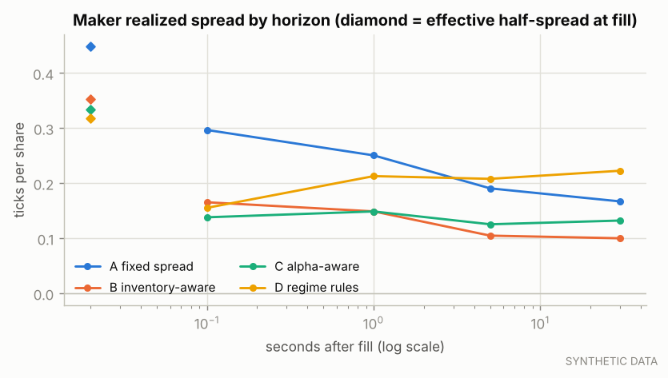

*Maker realized spread by horizon.*

## 12. Ablation experiments

| ablation | test net P&L | Δ vs full C | fills | mean abs inv. |
|---|---|---|---|---|
| no_alpha | $1,970.30 | -$310.80 | 6,692 | 99 |
| placebo_alpha | $1,857.40 | -$423.70 | 7,131 | 113 |
| no_alpha_shift | $1,970.30 | -$310.80 | 6,692 | 99 |
| no_alpha_guard | $2,281.10 | $0.00 | 7,008 | 95 |
| no_inventory_skew | $2,406.60 | $125.50 | 7,003 | 249 |
| no_vol_adaptation | $2,377.30 | $96.20 | 7,024 | 93 |
| fill_aware_glft | $1,920.40 | -$360.70 | 5,261 | 125 |
| drop:book_l1 | $2,266.70 | -$14.40 | 6,946 | 100 |
| drop:microprice | $2,325.30 | $44.20 | 7,004 | 95 |
| drop:multi_level | $2,256.20 | -$24.90 | 7,086 | 94 |
| drop:order_flow | $2,277.10 | -$4.00 | 7,008 | 94 |
| drop:trade_flow | $2,244.20 | -$36.90 | 6,986 | 95 |
| drop:order_flow+trade_flow+activity | $2,264.80 | -$16.30 | 7,044 | 95 |
| drop:price_history | $2,217.90 | -$63.20 | 7,042 | 90 |

`no_alpha` reduces C to B exactly (same parameters); `no_vol_adaptation` holds σ at its training-period mean; `fill_aware_glft` replaces B's fixed half-spread with GLFT quotes using the estimated fill intensity (H5); `drop:<groups>` retrains the selected model without those feature groups and re-runs C.

**Placebo check.** C fed its own alpha shifted by half a session (same distribution, no alignment with the market) earned $1,857.40, versus $1,970.30 for B (no alpha) and $2,281.10 for C with the real alpha. The placebo does not beat B, so the engine is not rewarding alpha-shaped noise.

Identical to the full strategy (the component is inactive in the validation-selected configuration, so the ablation removes nothing): `no_alpha_guard`.

| model variant | val log loss | test log loss | test AUC up | test IC |
|---|---|---|---|---|
| drop:book_l1 | 0.5042 | 0.5294 | 0.867 | 0.448 |
| drop:microprice | 0.4773 | 0.5076 | 0.875 | 0.447 |
| drop:multi_level | 0.4781 | 0.5125 | 0.871 | 0.443 |
| drop:order_flow | 0.4763 | 0.5081 | 0.876 | 0.449 |
| drop:trade_flow | 0.4817 | 0.5125 | 0.872 | 0.444 |
| drop:order_flow+trade_flow+activity | 0.4808 | 0.5127 | 0.872 | 0.447 |
| drop:price_history | 0.4732 | 0.5110 | 0.874 | 0.444 |
| full_model | 0.4750 | 0.5086 | 0.875 | 0.448 |

Incremental value of order-flow information (H2): test log-loss change when the group is removed: drop:order_flow: -0.00047, drop:trade_flow: 0.00397, drop:order_flow+trade_flow+activity: 0.00407 (positive = the group helped).

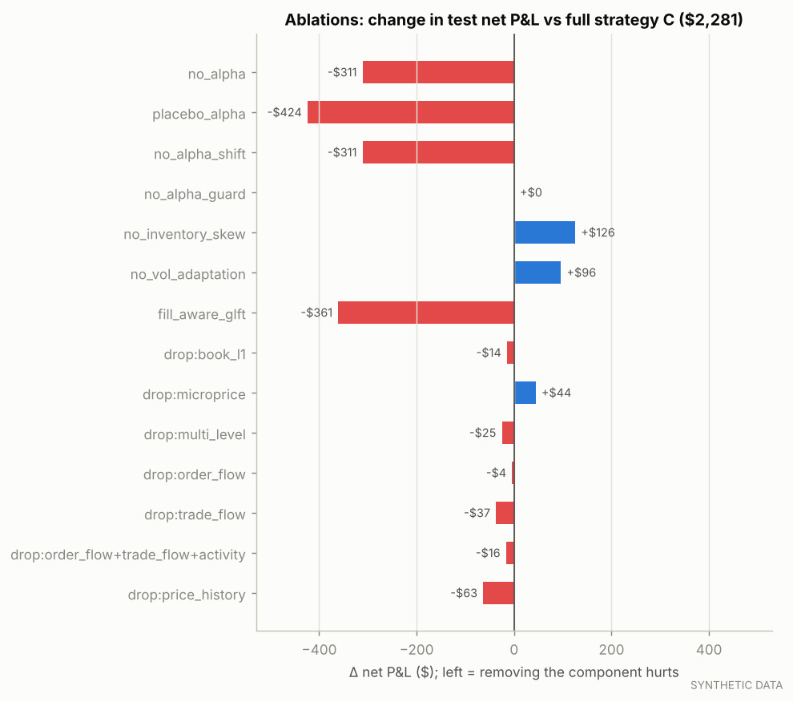

*Ablations of strategy C.*

## 13. Sensitivity and robustness

**latency_us**

| value | A fixed spread | B inventory-aware | C alpha-aware |
|---|---|---|---|
| 0 | $1,883.60 | $1,975.70 | $2,289.10 |
| 100 | $1,881.60 | $1,974.10 | $2,282.90 |
| 250 | $1,883.20 | $1,970.30 | $2,281.10 |
| 1000 | $1,879.40 | $1,964.30 | $2,280.90 |
| 5000 | $1,865.20 | $1,921.30 | $2,260.30 |
| 20000 | $1,794.40 | $1,815.30 | $2,089.00 |

**execution.fees.maker_per_share**

| value | A fixed spread | B inventory-aware | C alpha-aware |
|---|---|---|---|
| -0.003 | $2,399.00 | $2,639.20 | $2,981.60 |
| -0.002 | $1,883.20 | $1,970.30 | $2,281.10 |
| 0.0 | $851.60 | $632.50 | $880.10 |
| 0.001 | $335.80 | -$36.40 | $179.60 |

**execution.fill_preset**

| value | A fixed spread | B inventory-aware | C alpha-aware |
|---|---|---|---|
| conservative | $1,247.70 | $1,354.40 | $1,561.50 |
| central | $1,883.20 | $1,970.30 | $2,281.10 |
| optimistic | $7,684.60 | $7,283.50 | $7,780.10 |

**strategies.*.quote_size**

| value | A fixed spread | B inventory-aware | C alpha-aware |
|---|---|---|---|
| 100 | $1,883.20 | $1,970.30 | $2,281.10 |
| 200 | $2,560.00 | $2,635.50 | $2,958.60 |
| 300 | $3,172.60 | $3,198.20 | $3,458.70 |

**strategies.risk.max_inventory**

| value | A fixed spread | B inventory-aware | C alpha-aware |
|---|---|---|---|
| 200 | $1,722.80 | $1,932.40 | $2,201.00 |
| 500 | $1,883.20 | $1,970.30 | $2,281.10 |
| 1000 | $1,882.60 | $1,968.10 | $2,283.10 |

**strategies.*.gamma**

| value | A fixed spread | B inventory-aware | C alpha-aware |
|---|---|---|---|
| 0.02 | $1,883.20 | $1,970.30 | $2,281.10 |
| 0.1 | $1,883.20 | $1,564.60 | $1,779.00 |
| 0.3 | $1,883.20 | $1,516.80 | $1,706.80 |
| 1.0 | $1,883.20 | $1,506.00 | $1,699.40 |

**features.vol_window_s**

| value | A fixed spread | B inventory-aware | C alpha-aware |
|---|---|---|---|
| 10 | $1,883.20 | $1,923.80 | $2,205.50 |
| 30 | $1,883.20 | $1,970.30 | $2,281.10 |
| 120 | $1,883.20 | $2,044.40 | $2,353.90 |

**models.labels.horizon_ms**

| value | A fixed spread | B inventory-aware | C alpha-aware |
|---|---|---|---|
| 250 | $1,883.20 | $1,970.30 | $2,182.00 |
| 1000 | $1,883.20 | $1,970.30 | $2,281.10 |
| 5000 | $1,883.20 | $1,970.30 | $2,303.10 |

**backtest.decision_min_interval_ms**

| value | A fixed spread | B inventory-aware | C alpha-aware |
|---|---|---|---|
| 0 | $1,883.20 | $1,970.30 | $2,281.10 |
| 100 | $1,832.50 | $1,899.60 | $2,179.00 |
| 1000 | $1,449.60 | $1,384.70 | $1,550.00 |

**strategies.*.half_spread_ticks**

| value | A fixed spread | B inventory-aware | C alpha-aware |
|---|---|---|---|
| 0.5 | $1,883.20 | $1,970.30 | $2,281.10 |
| 1.5 | $56.30 | $260.20 | $239.70 |

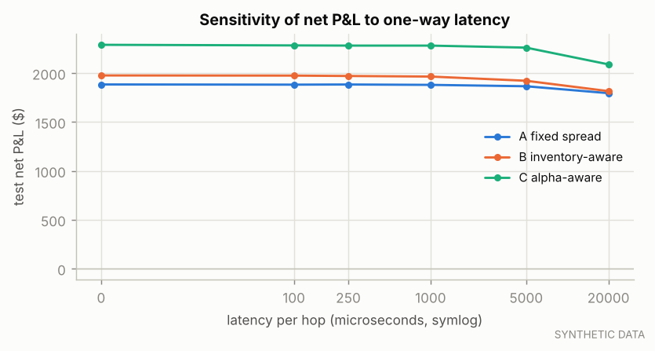

*Net P&L vs latency.*

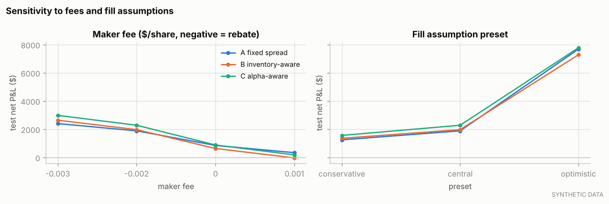

*Net P&L vs maker fee and fill-assumption preset.*

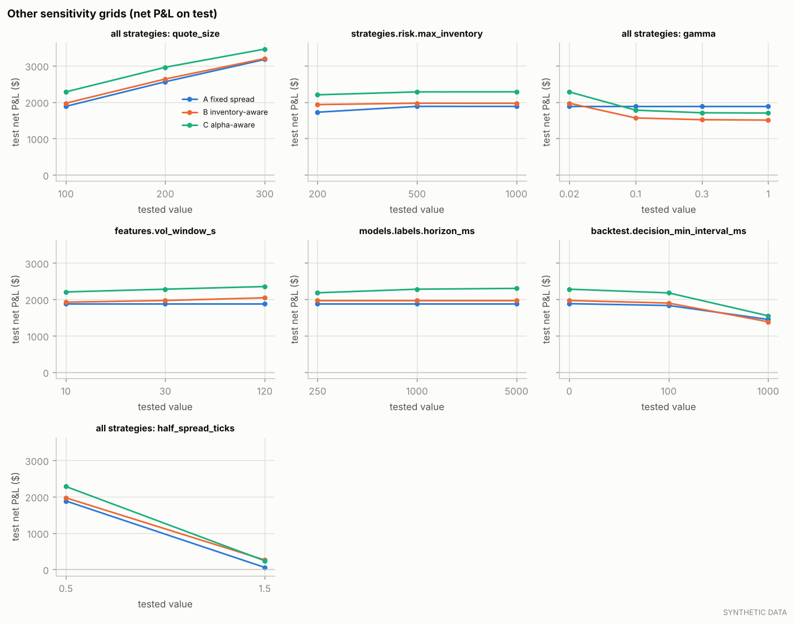

*Other sensitivity grids.*

**Where results change sign (H7):**

- B inventory-aware changes sign across `execution.fees.maker_per_share` (-$36.40 to $2,639.20)
- the ranking of C vs A flips across `execution.fees.maker_per_share`
- the ranking of C vs A flips across `strategies.*.gamma`

## 14. Statistical uncertainty

| comparison (first − second) | paired intervals | mean / interval | 95% low | 95% high | share of draws ≤ 0 | verdict |
|---|---|---|---|---|---|---|
| inventory_aware - fixed_spread | 112 | $0.778 | -$0.542 | $2.117 | 0.127 | not established (95% CI includes 0) |
| adaptive - inventory_aware | 112 | $2.775 | $1.944 | $3.595 | 0.000 | supported |
| adaptive - fixed_spread | 112 | $3.553 | $2.019 | $5.018 | 0.000 | supported |
| regime - adaptive | 112 | -$3.387 | -$4.050 | -$2.714 | 1.000 | contradicted |

Risk-adjusted (mean / std of interval net P&L, not annualised), paired circular block bootstrap:

| comparison | first | second | difference | 95% low | 95% high | verdict |
|---|---|---|---|---|---|---|
| inventory_aware - fixed_spread | 2.927 | 1.769 | 1.158 | 0.744 | 1.754 | supported |
| adaptive - inventory_aware | 3.626 | 2.927 | 0.699 | 0.341 | 1.492 | supported |
| adaptive - fixed_spread | 3.626 | 1.769 | 1.857 | 1.195 | 3.013 | supported |
| regime - adaptive | 2.990 | 3.626 | -0.636 | -1.248 | -0.333 | contradicted |

Intervals are 60 s of clock time within a session; circular blocks of consecutive intervals wrap within a session and never span sessions. Dependence longer than a block, and differences between sessions as a whole, are not captured.

**Multiple testing.** 9 parameter candidates were evaluated on validation and 498 backtests were run overall. Only the pre-declared final comparisons above are confirmatory; sensitivity and ablation results are exploratory, and a best case picked from them would be biased upward by selection.

## 15. Failure cases and negative results

- B inventory-aware changes sign across `execution.fees.maker_per_share` (-$36.40 to $2,639.20)
- the ranking of C vs A flips across `execution.fees.maker_per_share`
- the ranking of C vs A flips across `strategies.*.gamma`

## 16. Limitations

- **Synthetic market.** The generating process (latent value, informed flow, Poisson order arrivals) is the project's own; real markets are non-stationary, have richer participant behaviour and queue dynamics.
- **No market impact.** Simulated orders do not change other participants' behaviour or remove liquidity from history.
- **Queue uncertainty.** Hidden/reserve liquidity ahead of us is unobservable; messages beyond the recorded depth are absent.
- **Latency is a constant.** No jitter, gateway queueing or exchange-side processing.
- **Fees are illustrative.** Maker rebates matter a lot for one-tick markets (see sensitivity).
- **Statistics.** Intra-session block bootstrap; few sessions; many backtests were run (selection risk).
See `docs/limitations.md` for the full discussion.

## 17. Conclusions

- On this synthetic sample, the alpha-aware strategy versus the fixed-spread benchmark on risk-adjusted net P&L: supported.
- The direction model's out-of-sample gain over a constant-probability forecast: supported.
- The alpha component itself (C vs B, everything else identical): supported.
- Inventory control (B vs A) changes mean absolute inventory from 248 to 99 shares; its risk-adjusted effect: supported.

Because the data are synthetic, these conclusions describe the simulator's market, not a real one. The decisive next step is running the identical protocol on historical LOBSTER data.

## 18. Next research steps

- Run `configs/experiments/lobster_msft.yaml` and `lobster_aapl.yaml` on the real samples (large-tick vs small-tick).
- Use more sessions (paid LOBSTER history or Databento MBO, after a cost check) for cross-session walk-forward.
- Queue-position-aware quoting: choose join/step-back from the fill model's P(fill) and expected markout.
- Latency distributions instead of constants; an impact model for our own orders.

## 19. Reproduction

```bash
pip install -e ".[dev]"
pytest
amm experiment run --config configs/experiments/baseline_comparison.yaml --overwrite
amm report --experiment synthetic_informed_baseline
```

The exact configuration is saved next to this report as `config_snapshot.yaml` (as run) and `config_selected.yaml` (with validation-selected parameters); data provenance is in `manifests.json`.
