# Adaptive Market Maker — research report: `synthetic_null_baseline`

> **SYNTHETIC DATA (Mode 2).** These results come from the project's simulated order-level market, not from historical market data. They test whether the research machinery behaves correctly on a market with known properties; they are **not evidence that any strategy is profitable in a real market**.

_Same protocol as synthetic_informed_baseline on the uninformed (null) synthetic market._

## 1. Executive summary

| strategy | net P&L (primary) | 95% CI | gross P&L | fees net of rebates | fills | mean abs inventory (sh) | worst max drawdown |
|---|---|---|---|---|---|---|---|
| A fixed spread | $2,533.00 | [$2,370.08, $2,697.53] | $1,690.00 | -$843.00 | 4,234 | 242 | $10.60 |
| B inventory-aware | $2,585.70 | [$2,450.20, $2,715.22] | $1,597.00 | -$988.70 | 4,946 | 151 | $10.00 |
| C alpha-aware | $2,556.20 | [$2,416.87, $2,699.90] | $1,528.00 | -$1,028.20 | 5,154 | 174 | $10.20 |
| D regime rules | $2,402.50 | [$2,254.28, $2,541.84] | $1,458.00 | -$944.50 | 4,736 | 178 | $10.00 |

Net P&L is after modelled fees and rebates with any residual inventory liquidated at the far touch (walking visible depth, taker fee). Fees below zero are net rebates. Confidence intervals come from a circular block bootstrap of 60-second P&L intervals.

**Hypothesis verdicts (mechanical, 95% intervals):**

- **H1** (C beats A on risk-adjusted net P&L): supported; mean/std of interval P&L 3.467 vs 3.112, difference 0.355 [0.115, 0.772]. Raw net P&L difference per interval $0.207 [-$0.471, $0.926] (not established (95% CI includes 0)).
- **H2** (features predict out of sample): supported; test log-loss gain of `logistic` vs prior 0.1220 nats [0.1082, 0.1351].
- **H3** (alpha survives costs: C beats B): not established (95% CI includes 0); -$0.263 per interval [-$0.801, $0.277].
- **H4** (inventory control improves risk-adjusted P&L: B vs A): supported; risk-adjusted difference 0.558 [0.282, 1.115]; raw net P&L not established (95% CI includes 0); mean abs inventory 242 → 151 shares.
- **H6** (regime dependence), C − B mark-to-mid P&L by regime: volatility=high: -$3; volatility=low: -$6; volatility=mid: -$21; spread=1 tick: -$19; spread=>1 tick: -$11; flow=balanced: -$2; flow=directional: -$28 (descriptive).
- **H7** (robustness): see section 13 for every sensitivity grid and where results change sign.

## 2. Research question and hypotheses

Does a market maker that adapts its quotes to short-horizon price forecasts, execution conditions and inventory risk outperform simpler market makers under realistic replay assumptions?

| hypothesis | experiment | metric | baseline | verdict |
|---|---|---|---|---|
| H1 adaptive > fixed, risk-adjusted | test backtests | paired mean/std of interval net P&L | A fixed spread | supported |
| H2 incremental short-horizon information | direction models + feature ablations | test log loss vs prior; Δ when dropping flow groups | constant-probability prior | supported |
| H3 signal survives costs | C vs B (identical except alpha) | paired interval net P&L | B inventory-aware | not established (95% CI includes 0) |
| H4 inventory control improves risk-adjusted P&L | B vs A | paired mean/std of interval net P&L; inventory | A fixed spread | supported |
| H5 fill-aware quoting | GLFT with estimated fill intensity vs B | net P&L (point estimate) | B | point estimate only |
| H6 regime dependence | P&L by causal regime | P&L per regime | C vs B by regime | descriptive |
| H7 robustness | sensitivity grids | sign changes of net P&L | selected configuration | descriptive |

## 3. Dataset and quality assessment

Dataset `synthetic_null` (source: **synthetic**).

| session | messages | observable states | mid drift (ticks) | validation | flagged checks |
|---|---|---|---|---|---|
| SYNTH_2099-01-05 | 76,969 | 75,294 | 9.5 | PASSED | none |
| SYNTH_2099-01-06 | 77,775 | 76,122 | -11.5 | PASSED | none |
| SYNTH_2099-01-07 | 77,204 | 75,515 | 15.5 | PASSED | none |
| SYNTH_2099-01-08 | 77,877 | 76,316 | -9.5 | PASSED | none |
| SYNTH_2099-01-09 | 77,779 | 76,153 | -9.5 | PASSED | none |
| SYNTH_2099-01-12 | 77,380 | 75,733 | -18.5 | PASSED | none |
| SYNTH_2099-01-13 | 77,887 | 76,249 | 16.5 | PASSED | none |
| SYNTH_2099-01-14 | 77,620 | 75,906 | 4.5 | PASSED | none |
| SYNTH_2099-01-15 | 77,921 | 76,279 | 4.5 | PASSED | none |
| SYNTH_2099-01-16 | 77,572 | 75,912 | 2.5 | PASSED | none |

Mid drift (last − first mid) matters for reading side-specific markouts: in a session that drifts down, buy fills look adversely selected and sell fills look favourable, independent of the strategy.


Every book-changing message was reconciled against the source book snapshot (check `book_transitions_consistent`); critical failures stop the pipeline. Messages sharing one timestamp are treated as one observable state (only the last book in a burst could be observed).

| role | session | start (s after midnight) | end | duration (s) |
|---|---|---|---|---|
| train | SYNTH_2099-01-05 | 34,320.0 | 35,970.0 | 1,650 |
| train | SYNTH_2099-01-06 | 34,320.0 | 35,970.0 | 1,650 |
| train | SYNTH_2099-01-07 | 34,320.0 | 35,970.0 | 1,650 |
| train | SYNTH_2099-01-08 | 34,320.1 | 35,970.0 | 1,650 |
| val | SYNTH_2099-01-09 | 34,320.0 | 35,970.0 | 1,650 |
| val | SYNTH_2099-01-12 | 34,320.0 | 35,970.0 | 1,650 |
| test | SYNTH_2099-01-13 | 34,320.1 | 35,970.0 | 1,650 |
| test | SYNTH_2099-01-14 | 34,320.1 | 35,970.0 | 1,650 |
| test | SYNTH_2099-01-15 | 34,320.0 | 35,970.0 | 1,650 |
| test | SYNTH_2099-01-16 | 34,320.0 | 35,969.9 | 1,650 |

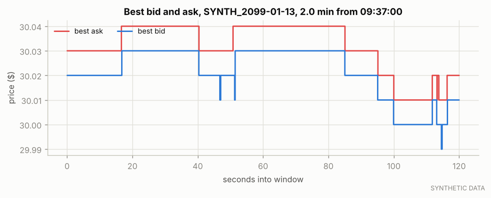

*Best bid and ask over a representative interval of the first test session.*

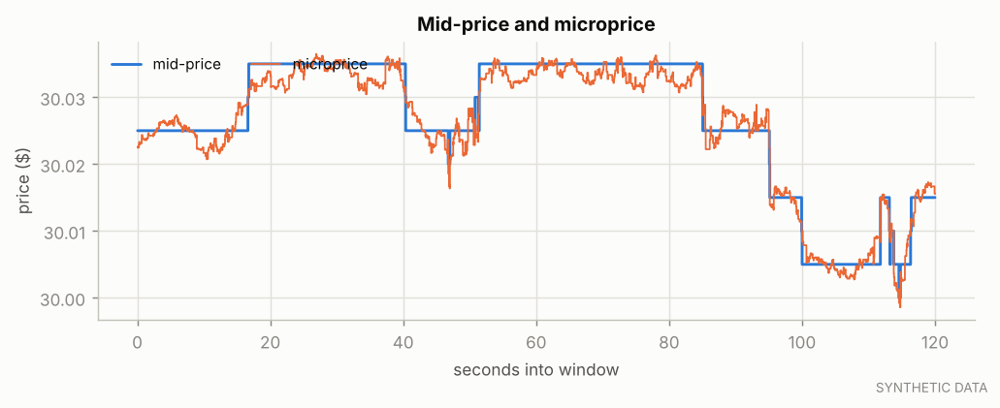

*Mid-price and microprice.*

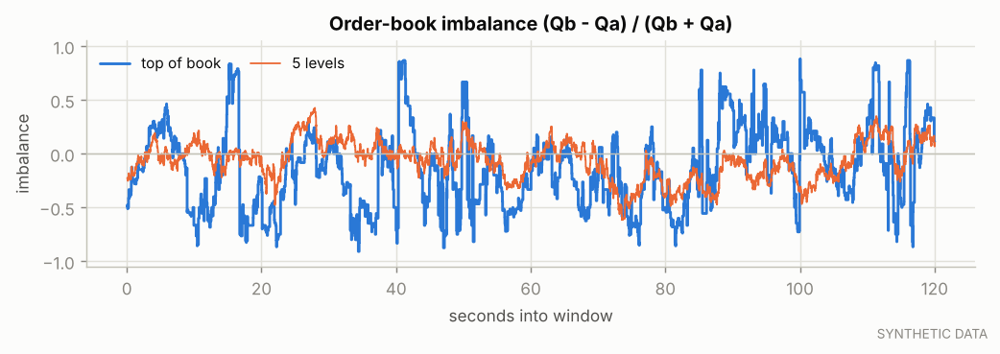

*Top-of-book and 5-level imbalance.*

## 4. Methodology

1. Validate data; build causal features on observable states; labels = as-of mid change over the horizon.
2. Chronological train / validation / test segments; labels purged at segment ends.
3. Direction models fit on train, temperature-calibrated on the first half of validation, selected by log loss on the second half (non-overlapping labels).
4. Strategy parameters chosen on validation only from small pre-declared grids; C inherits B's choice so C − B isolates the alpha component.
5. Every strategy is run once on identical test segments; robustness grids and ablations are reported on test but never used to re-select anything.

## 5. Feature definitions

See `docs/mathematical_model.md` for formulas. Feature groups used by the models:

42 features: `spread_ticks`, `imb_l1`, `log_bid_sz1`, `log_ask_sz1`, `micro_minus_mid`, `imb_l3`, `log_depth_ratio_l3`, `imb_l5`, `log_depth_ratio_l5`, `imb_l10`, `log_depth_ratio_l10`, `d_best_bid_e1`, `d_best_ask_e1`, `ret_e10`, `ret_e50`, `ret_e200`, `ret_t1`, `ret_t5`, `ret_t30`, `rv_t30`, `ofi_e10`, `ofi_e50`, `ofi_e200`, `ofi_t1`, `ofi_t5`, `ofi_t30`, `signed_vol_t1`, `trade_imb_t1`, `mo_rate_t1`, `signed_vol_t5`, `trade_imb_t5`, `mo_rate_t5`, `signed_vol_t30`, `trade_imb_t30`, `mo_rate_t30`, `cancel_rate_t5`, `submit_rate_t5`, `update_rate_t5`, `touch_replenish_t5`, `secs_since_mid_change`, `secs_since_trade`, `session_frac`

## 6. Predictive-model evaluation

Target: ternary sign of the as-of mid change over **1000ms**. Train/val-cal/val-select/test samples: 278,075 / 69,361 / 1,611 / 6,444 (validation-select and test use non-overlapping labels).

| model | T | val log loss | test log loss | test gain vs prior (95% CI) | accuracy | balanced acc. | Brier | AUC up | AUC dir. given move | IC (Spearman) |
|---|---|---|---|---|---|---|---|---|---|---|
| prior | 1.00 | 0.3707 | 0.3952 | — | 0.900 | 0.333 | 0.1855 | 0.500 | 0.500 | n/a |
| **logistic** | 1.01 | 0.2489 | 0.2732 | 0.1220 [0.1082, 0.1351] | 0.910 | 0.434 | 0.1439 | 0.879 | 0.766 | 0.222 |
| hgb | 1.05 | 0.2548 | 0.2726 | 0.1226 [0.1095, 0.1355] | 0.909 | 0.426 | 0.1441 | 0.872 | 0.755 | 0.209 |

Selected (bold): `logistic`. Test class balance (down/flat/up): -1: 4.9%, 0: 90.0%, 1: 5.1%. Accuracy alone is misleading when the flat class dominates; log loss and the directional AUC are the informative measures.

| regime dimension | regime | n | log loss | accuracy | AUC up |
|---|---|---|---|---|---|
| volatility | high | 2,103 | 0.3144 | 0.897 | 0.848 |
| volatility | low | 1,844 | 0.2258 | 0.924 | 0.912 |
| volatility | mid | 2,497 | 0.2736 | 0.909 | 0.881 |
| spread | 1 tick | 6,253 | 0.2518 | 0.923 | 0.859 |
| spread | >1 tick | 191 | 0.9751 | 0.482 | 0.509 |

Selected model by test session:

| session | n | log loss | accuracy | AUC up |
|---|---|---|---|---|
| SYNTH_2099-01-13 | 1,610 | 0.2587 | 0.916 | 0.858 |
| SYNTH_2099-01-14 | 1,612 | 0.2744 | 0.908 | 0.882 |
| SYNTH_2099-01-15 | 1,612 | 0.2892 | 0.900 | 0.894 |
| SYNTH_2099-01-16 | 1,610 | 0.2705 | 0.914 | 0.879 |

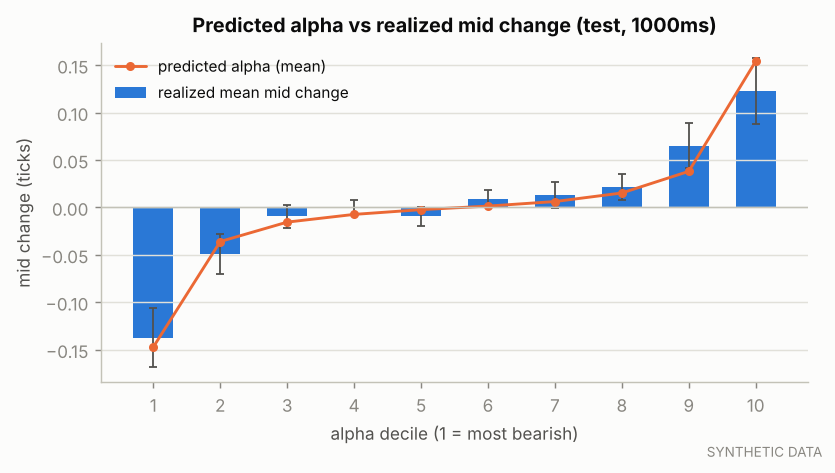

*Realized mid change by decile of the model's alpha (test); bars show ±1.96 SE.*

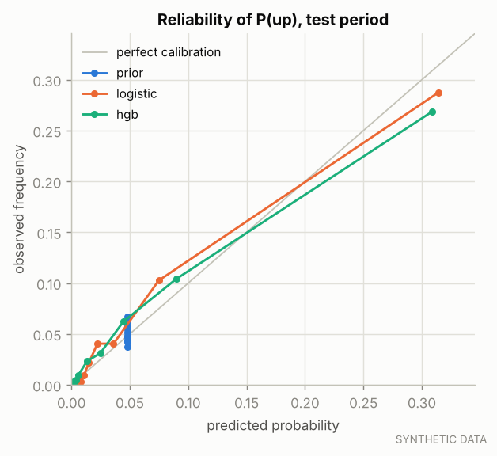

*Reliability diagram for P(up) on the test period.*

## 7. Execution simulator and assumptions

| assumption | value |
|---|---|
| execution mode | synthetic_market_replay |
| fill preset | central |
| latency (µs, per hop) | {"market_data_us": 250.0, "decision_us": 20.0, "order_entry_us": 250.0, "report_us": 250.0} |
| fees ($/share) | {"maker_per_share": -0.002, "taker_per_share": 0.003} |
| post-only quotes | True |
| flatten before end (s) | 30.0 |
| risk limits | {"max_inventory": 500, "max_order_size": 300, "max_outstanding_per_side": 300, "max_notional": 250000.0, "max_actions_per_second": 20.0, "max_market_spread_ticks": 10, "max_price_deviation_ticks": 10, "max_session_loss": 2000.0, "stale_data_s": 5.0} |

The central preset tracks the visible queue ahead of each simulated order exactly using order ids (orders whose submission was never seen rested earlier and are ahead; later orders are behind). Simulated orders do not change other participants' behaviour and do not remove liquidity from the historical record. See `docs/execution_assumptions.md`.

**Fill-probability model** (shadow 1-lot orders, 10.0 s horizon, preset `central`): test n = 4,000, observed fill rate 58.1% (by ticks behind best: 0: 94.1%, 1: 22.1%); Brier 0.1085 vs base-rate 0.2435; AUC 0.907.
 Estimated fill intensity λ(δ) = A·exp(−kδ): A = 0.858 /s, k = 2.409 /tick (training shadow orders).

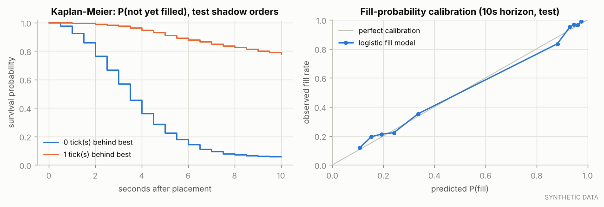

*Time-to-fill survival curves and fill-probability calibration (test shadow orders).*

## 8. Strategy definitions and selected parameters

A: fixed half-spread around the mid. B: Avellaneda–Stoikov-style reservation price r = S − q·γ·σ²·τ (q in lots, σ in ticks/√s, rolling τ) with the same half-spread as A. C: B plus r += clip(α) and an adverse-selection guard that withdraws the side α says will be picked off. D: C plus causal regime rules (stop quoting in high realized volatility, widen when the market spread is wide).

| strategy | selected on validation | candidates | validation net P&L by candidate |
|---|---|---|---|
| A fixed spread | {"half_spread_ticks": 0.5} | 2 | {"half_spread_ticks": 0.5} → $1,222.50; {"half_spread_ticks": 1.5} → $46.20 |
| B inventory-aware | {"gamma": 0.02} | 3 | {"gamma": 0.02} → $1,236.30; {"gamma": 0.1} → $1,160.70; {"gamma": 0.3} → $1,071.90 |
| C alpha-aware | {"alpha_guard_ticks": null} | 3 | {"alpha_guard_ticks": 0.15} → $1,062.30; {"alpha_guard_ticks": 0.3} → $1,169.00; {"alpha_guard_ticks": null} → $1,214.50 |
| D regime rules | defaults | 1 | {} → $1,139.50 |

## 9. Backtesting methodology

Event-driven replay with explicit latency; historical messages win timestamp ties. Each strategy ran on the same 4 test segment(s) with identical data, fees, latency, limits and simulator. 118 backtests were run in total (all logged in `trials.csv`).

## 10. Benchmark results

| strategy | net P&L | net P&L (mid-marked) | orders | fills | fill rate | shares traded | max abs inventory | net P&L / share | mean/std of 60s P&L |
|---|---|---|---|---|---|---|---|---|---|
| A fixed spread | $2,533.00 | $2,533.00 | 5,774 | 4,234 | 73.3% | 424,000 | 500 | $0.0060 | 3.151 |
| B inventory-aware | $2,585.70 | $2,585.70 | 6,644 | 4,946 | 74.5% | 494,600 | 500 | $0.0052 | 3.675 |
| C alpha-aware | $2,556.20 | $2,556.20 | 7,416 | 5,154 | 69.5% | 515,600 | 500 | $0.0050 | 3.516 |
| D regime rules | $2,402.50 | $2,402.50 | 7,645 | 4,736 | 62.0% | 474,000 | 500 | $0.0051 | 3.432 |

Per-segment results:

| strategy | segment | net P&L | fills | mean abs inv. | max drawdown | kill switch |
|---|---|---|---|---|---|---|
| A fixed spread | SYNTH_2099-01-13 | $612.50 | 1,048 | 237 | $9.80 |  |
| A fixed spread | SYNTH_2099-01-14 | $686.50 | 1,100 | 243 | $10.60 |  |
| A fixed spread | SYNTH_2099-01-15 | $593.40 | 1,029 | 248 | $9.30 |  |
| A fixed spread | SYNTH_2099-01-16 | $640.60 | 1,057 | 240 | $9.20 |  |
| B inventory-aware | SYNTH_2099-01-13 | $612.20 | 1,216 | 159 | $6.90 |  |
| B inventory-aware | SYNTH_2099-01-14 | $685.40 | 1,282 | 127 | $6.90 |  |
| B inventory-aware | SYNTH_2099-01-15 | $624.90 | 1,212 | 159 | $10.00 |  |
| B inventory-aware | SYNTH_2099-01-16 | $663.20 | 1,236 | 157 | $4.30 |  |
| C alpha-aware | SYNTH_2099-01-13 | $611.30 | 1,252 | 193 | $8.60 |  |
| C alpha-aware | SYNTH_2099-01-14 | $687.70 | 1,346 | 164 | $10.20 |  |
| C alpha-aware | SYNTH_2099-01-15 | $602.30 | 1,264 | 162 | $9.30 |  |
| C alpha-aware | SYNTH_2099-01-16 | $654.90 | 1,292 | 178 | $5.00 |  |
| D regime rules | SYNTH_2099-01-13 | $554.50 | 1,148 | 194 | $8.60 |  |
| D regime rules | SYNTH_2099-01-14 | $659.60 | 1,218 | 177 | $8.60 |  |
| D regime rules | SYNTH_2099-01-15 | $564.80 | 1,163 | 165 | $10.00 |  |
| D regime rules | SYNTH_2099-01-16 | $623.60 | 1,207 | 176 | $6.30 |  |

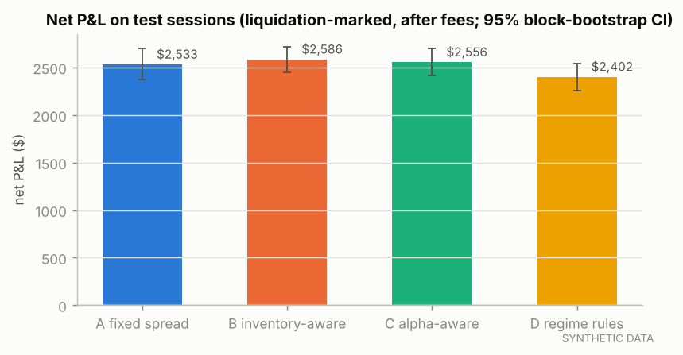

*Net P&L by strategy on the test segments.*

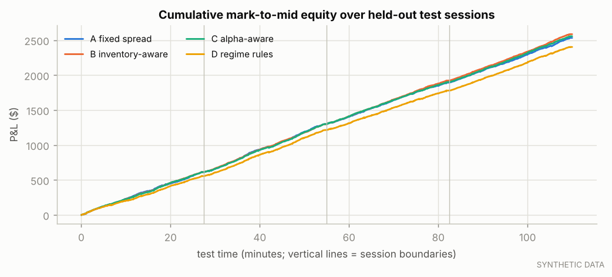

*Cumulative equity across test segments.*

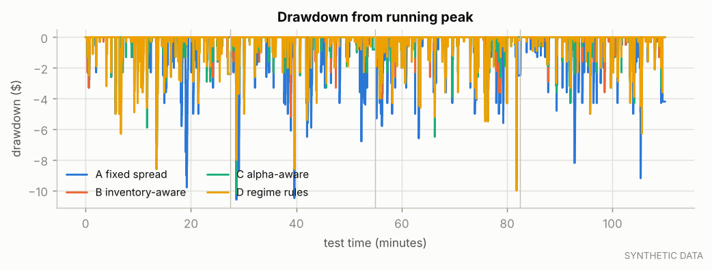

*Drawdown from the running peak.*

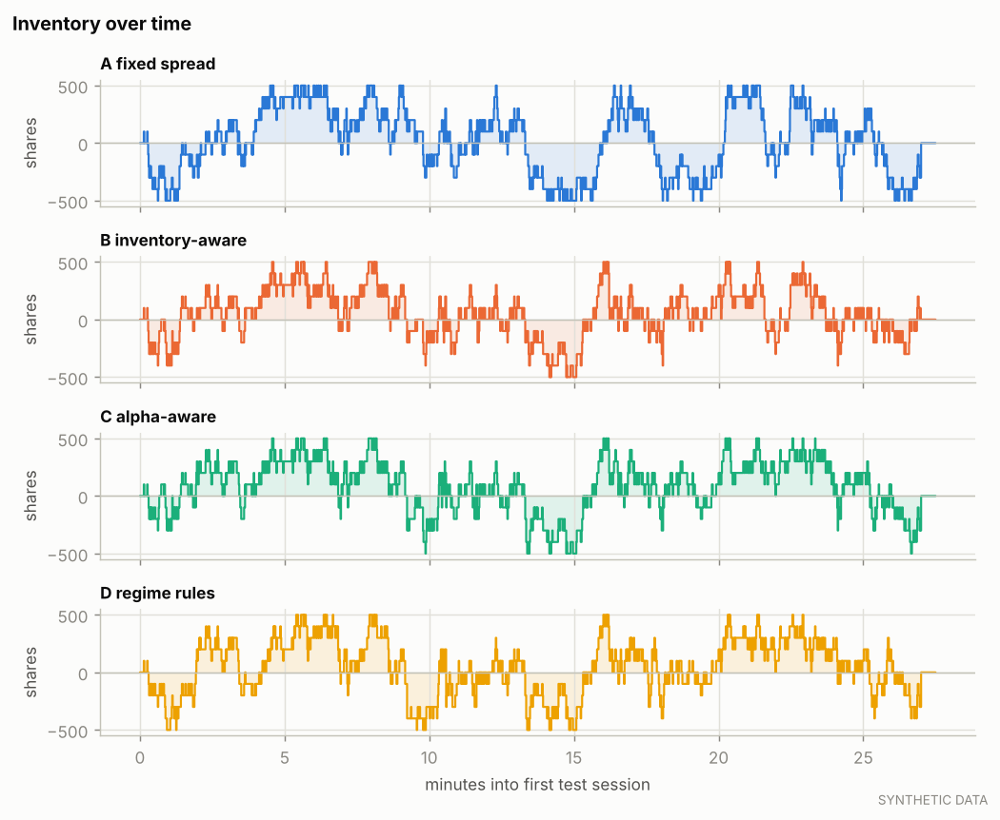

*Inventory paths in the first test session.*

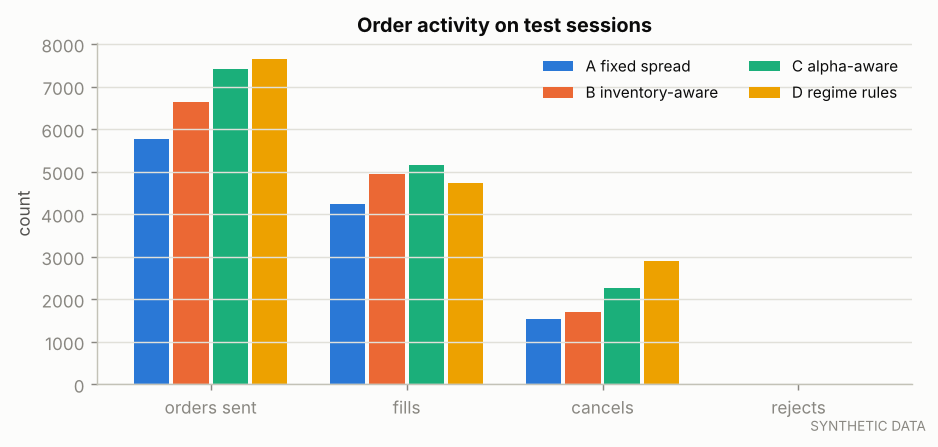

*Order, fill, cancel and reject counts.*

## 11. Transaction costs and adverse selection

Per maker fill (ticks per share, side-signed so positive = good for us): effective half-spread e = s(M₀ − P); adverse selection AS_h = −s(M_h − M₀); realized spread RS_h = e − AS_h = s(M_h − P). Fees are excluded here and added once in the last column.

| strategy | maker fills | e | RS 100ms | RS 1000ms | RS 5000ms | RS 30000ms | AS 30000ms | net $/share (longest h, incl. fees) |
|---|---|---|---|---|---|---|---|---|
| A fixed spread | 4,230 | 0.486 | 0.432 | 0.406 | 0.399 | 0.389 | 0.098 | $0.00588 |
| B inventory-aware | 4,945 | 0.436 | 0.352 | 0.333 | 0.324 | 0.325 | 0.111 | $0.00525 |
| C alpha-aware | 5,150 | 0.414 | 0.317 | 0.299 | 0.297 | 0.295 | 0.118 | $0.00495 |
| D regime rules | 4,733 | 0.411 | 0.327 | 0.309 | 0.309 | 0.306 | 0.105 | $0.00505 |

| strategy | side | fills | e (ticks) | RS longest h (ticks) |
|---|---|---|---|---|
| A fixed spread | sell | 2,117 | 0.486 | 0.235 |
| A fixed spread | buy | 2,117 | 0.484 | 0.542 |
| B inventory-aware | sell | 2,473 | 0.432 | 0.168 |
| B inventory-aware | buy | 2,473 | 0.439 | 0.482 |
| C alpha-aware | sell | 2,578 | 0.411 | 0.141 |
| C alpha-aware | buy | 2,576 | 0.415 | 0.450 |
| D regime rules | sell | 2,368 | 0.413 | 0.166 |
| D regime rules | buy | 2,368 | 0.408 | 0.446 |


Maker realized spread at the longest horizon by causal regime at the time of the fill (ticks):

| dimension | regime | A fixed spread | B inventory-aware | C alpha-aware | D regime rules |
|---|---|---|---|---|---|
| volatility | low | 0.393 (n=1,154) | 0.354 (n=1,270) | 0.320 (n=1,299) | 0.326 (n=1,233) |
| volatility | mid | 0.378 (n=1,620) | 0.310 (n=1,909) | 0.299 (n=1,989) | 0.324 (n=1,850) |
| volatility | high | 0.397 (n=1,456) | 0.320 (n=1,766) | 0.274 (n=1,862) | 0.271 (n=1,650) |
| spread | 1 tick | 0.433 (n=3,676) | 0.378 (n=4,206) | 0.351 (n=4,366) | 0.355 (n=4,138) |
| spread | >1 tick | 0.095 (n=554) | 0.021 (n=739) | -0.013 (n=784) | -0.032 (n=595) |
| flow | balanced | 0.393 (n=2,213) | 0.330 (n=2,552) | 0.290 (n=2,691) | 0.299 (n=2,468) |
| flow | directional | 0.383 (n=2,017) | 0.319 (n=2,393) | 0.302 (n=2,459) | 0.314 (n=2,265) |
| depth | thin | 0.356 (n=2,484) | 0.281 (n=3,058) | 0.236 (n=3,258) | 0.249 (n=2,931) |
| depth | deep | 0.436 (n=1,746) | 0.396 (n=1,887) | 0.398 (n=1,892) | 0.398 (n=1,802) |

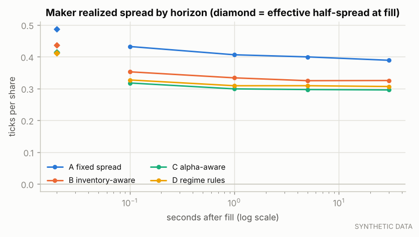

*Maker realized spread by horizon.*

## 12. Ablation experiments

| ablation | test net P&L | Δ vs full C | fills | mean abs inv. |
|---|---|---|---|---|
| no_alpha | $2,585.70 | $29.50 | 4,946 | 151 |
| placebo_alpha | $2,553.40 | -$2.80 | 5,171 | 162 |
| no_alpha_guard | $2,556.20 | $0.00 | 5,154 | 174 |

`no_alpha` reduces C to B exactly (same parameters); `no_vol_adaptation` holds σ at its training-period mean; `fill_aware_glft` replaces B's fixed half-spread with GLFT quotes using the estimated fill intensity (H5); `drop:<groups>` retrains the selected model without those feature groups and re-runs C.

**Placebo check.** C fed its own alpha shifted by half a session (same distribution, no alignment with the market) earned $2,553.40, versus $2,585.70 for B (no alpha) and $2,556.20 for C with the real alpha. The placebo does not beat B, so the engine is not rewarding alpha-shaped noise.

Identical to the full strategy (the component is inactive in the validation-selected configuration, so the ablation removes nothing): `no_alpha_guard`.

| model variant | val log loss | test log loss | test AUC up | test IC |
|---|---|---|---|---|
| full_model | 0.2489 | 0.2732 | 0.879 | 0.222 |
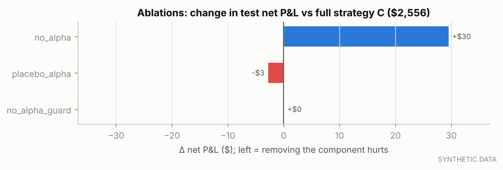

*Ablations of strategy C.*

## 13. Sensitivity and robustness

**latency_us**

| value | A fixed spread | B inventory-aware | C alpha-aware |
|---|---|---|---|
| 0 | $2,535.40 | $2,583.70 | $2,557.80 |
| 250 | $2,533.00 | $2,585.70 | $2,556.20 |
| 5000 | $2,535.90 | $2,563.50 | $2,551.20 |

**execution.fill_preset**

| value | A fixed spread | B inventory-aware | C alpha-aware |
|---|---|---|---|
| conservative | $1,876.60 | $1,957.30 | $1,946.40 |
| central | $2,533.00 | $2,585.70 | $2,556.20 |
| optimistic | $12,109.90 | $11,902.70 | $11,865.00 |

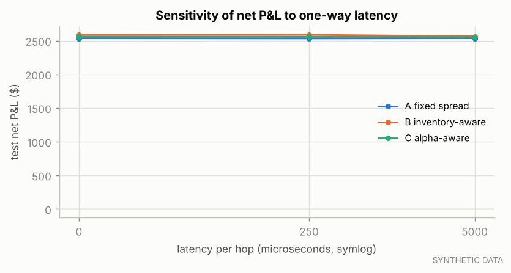

*Net P&L vs latency.*

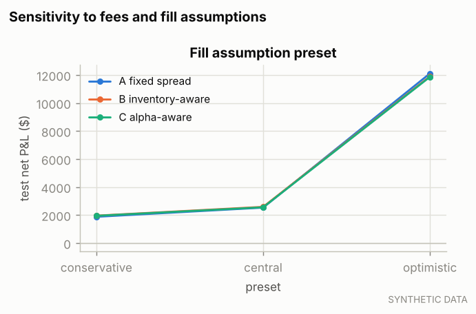

*Net P&L vs maker fee and fill-assumption preset.*

**Where results change sign (H7):**

- the ranking of C vs A flips across `execution.fill_preset`

## 14. Statistical uncertainty

| comparison (first − second) | paired intervals | mean / interval | 95% low | 95% high | share of draws ≤ 0 | verdict |
|---|---|---|---|---|---|---|
| inventory_aware - fixed_spread | 112 | $0.471 | -$0.338 | $1.273 | 0.124 | not established (95% CI includes 0) |
| adaptive - inventory_aware | 112 | -$0.263 | -$0.801 | $0.277 | 0.828 | not established (95% CI includes 0) |
| adaptive - fixed_spread | 112 | $0.207 | -$0.471 | $0.926 | 0.281 | not established (95% CI includes 0) |
| regime - adaptive | 112 | -$1.372 | -$1.788 | -$0.971 | 1.000 | contradicted |

Risk-adjusted (mean / std of interval net P&L, not annualised), paired circular block bootstrap:

| comparison | first | second | difference | 95% low | 95% high | verdict |
|---|---|---|---|---|---|---|
| inventory_aware - fixed_spread | 3.670 | 3.112 | 0.558 | 0.282 | 1.115 | supported |
| adaptive - inventory_aware | 3.467 | 3.670 | -0.203 | -0.543 | -0.017 | contradicted |
| adaptive - fixed_spread | 3.467 | 3.112 | 0.355 | 0.115 | 0.772 | supported |
| regime - adaptive | 3.343 | 3.467 | -0.124 | -0.453 | 0.124 | not established (95% CI includes 0) |

Intervals are 60 s of clock time within a session; circular blocks of consecutive intervals wrap within a session and never span sessions. Dependence longer than a block, and differences between sessions as a whole, are not captured.

**Multiple testing.** 9 parameter candidates were evaluated on validation and 118 backtests were run overall. Only the pre-declared final comparisons above are confirmatory; sensitivity and ablation results are exploratory, and a best case picked from them would be biased upward by selection.

## 15. Failure cases and negative results

- H3: not established (95% CI includes 0).
- the ranking of C vs A flips across `execution.fill_preset`

## 16. Limitations

- **Synthetic market.** The generating process (latent value, informed flow, Poisson order arrivals) is the project's own; real markets are non-stationary, have richer participant behaviour and queue dynamics.
- **No market impact.** Simulated orders do not change other participants' behaviour or remove liquidity from history.
- **Queue uncertainty.** Hidden/reserve liquidity ahead of us is unobservable; messages beyond the recorded depth are absent.
- **Latency is a constant.** No jitter, gateway queueing or exchange-side processing.
- **Fees are illustrative.** Maker rebates matter a lot for one-tick markets (see sensitivity).
- **Statistics.** Intra-session block bootstrap; few sessions; many backtests were run (selection risk).
See `docs/limitations.md` for the full discussion.

## 17. Conclusions

- On this synthetic sample, the alpha-aware strategy versus the fixed-spread benchmark on risk-adjusted net P&L: supported.
- The direction model's out-of-sample gain over a constant-probability forecast: supported.
- The alpha component itself (C vs B, everything else identical): not established (95% CI includes 0).
- Inventory control (B vs A) changes mean absolute inventory from 242 to 151 shares; its risk-adjusted effect: supported.

Because the data are synthetic, these conclusions describe the simulator's market, not a real one. The decisive next step is running the identical protocol on historical LOBSTER data.

## 18. Next research steps

- Run `configs/experiments/lobster_msft.yaml` and `lobster_aapl.yaml` on the real samples (large-tick vs small-tick).
- Use more sessions (paid LOBSTER history or Databento MBO, after a cost check) for cross-session walk-forward.
- Queue-position-aware quoting: choose join/step-back from the fill model's P(fill) and expected markout.
- Latency distributions instead of constants; an impact model for our own orders.

## 19. Reproduction

```bash
pip install -e ".[dev]"
pytest
amm experiment run --config configs/experiments/null_scenario.yaml --overwrite
amm report --experiment synthetic_null_baseline
```

The exact configuration is saved next to this report as `config_snapshot.yaml` (as run) and `config_selected.yaml` (with validation-selected parameters); data provenance is in `manifests.json`.
